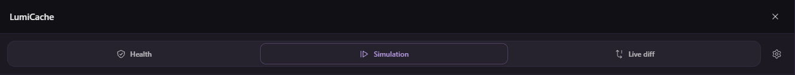
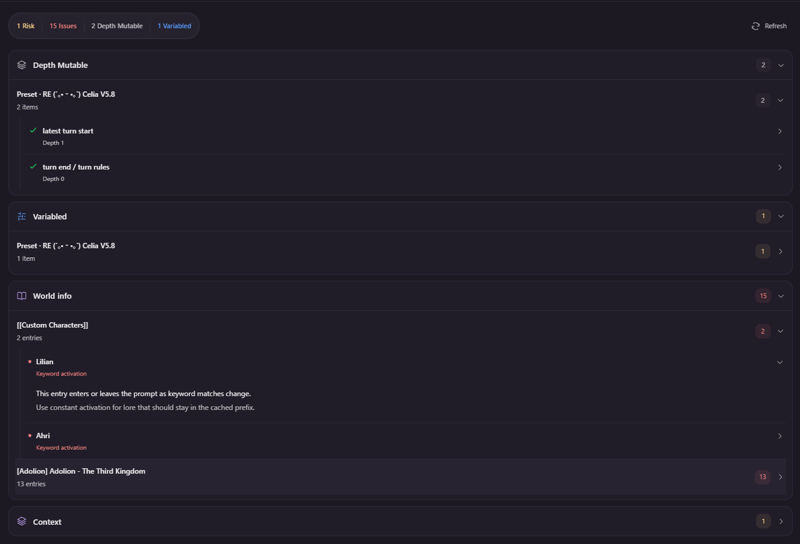
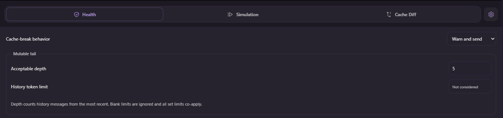
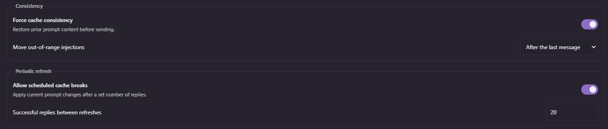
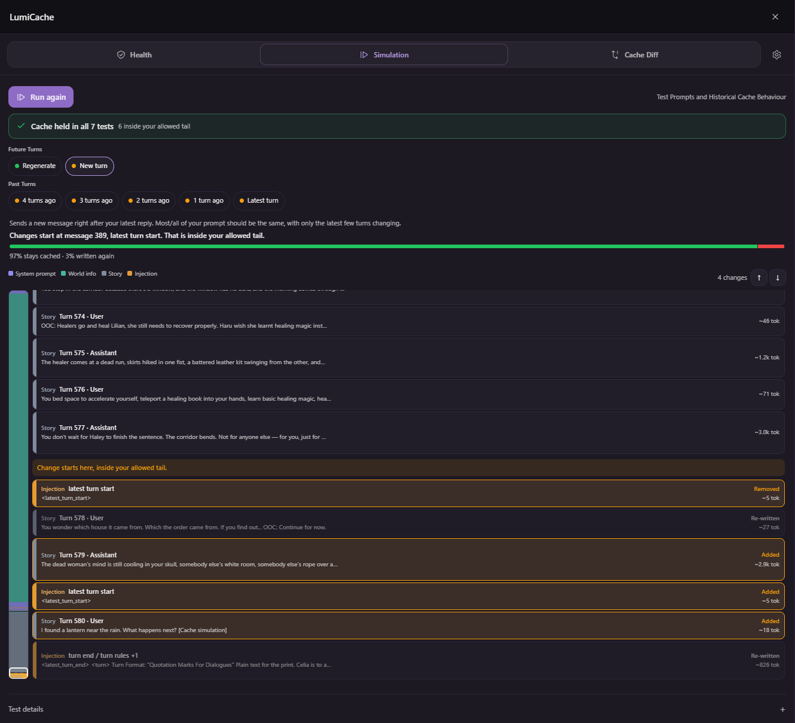
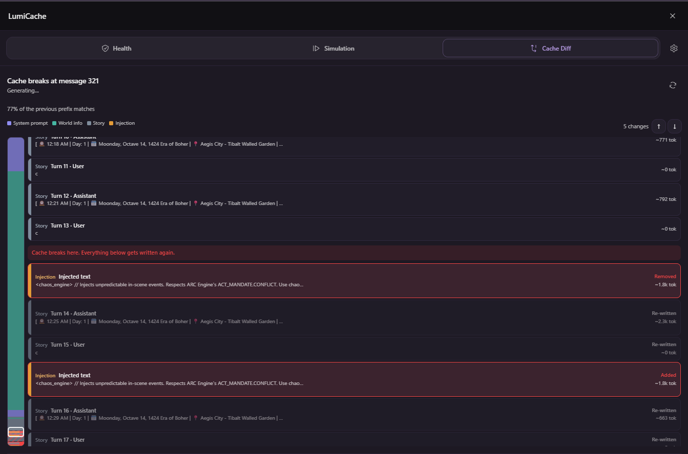
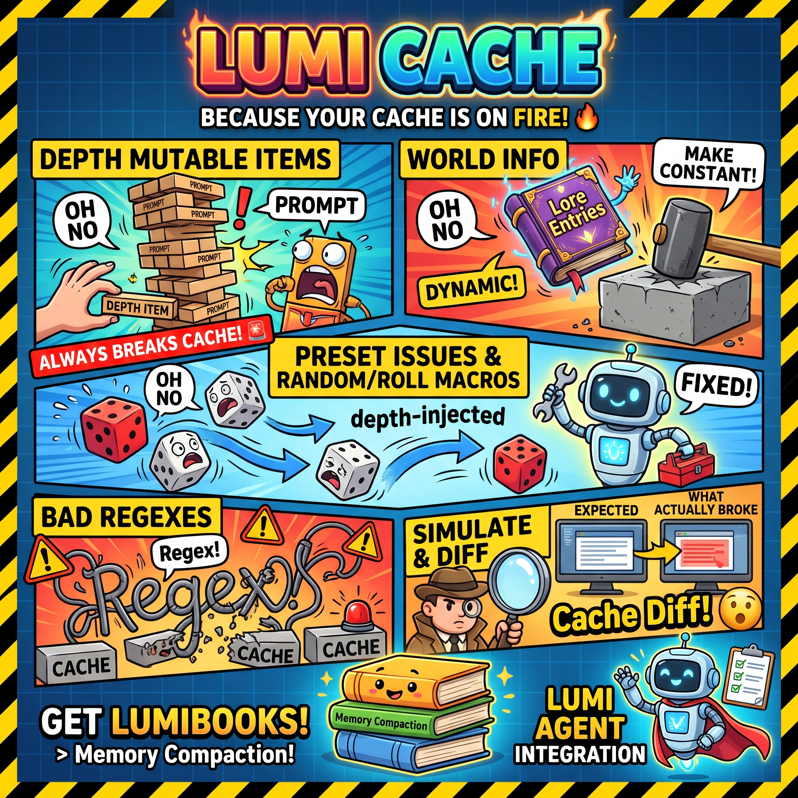

# LumiCache

*For many including myself, caching during RP has been some far away dream. A garden of salvation in the desert. A glimmer of hope in the darkness. And yet, despite your best efforts, you helplessly watch as the money you've earned with your gradually dwindling lifespan withers away into nothing but dust, leaving you in a dark and destitute wasteland for the rest of your puny life. And at the end you may wonder, "for what reason did I suffer?"*

*But do not despair, for not all is lost.*

---

**Anyways, this extension tells you if cache will be broken, what broke it, and gives steps to fix the parts that break it.** Also lets you simulate chats to test cache consistency so you don't need to actually destroy your wallet. Just hypothetically.

You should use this with __[LumiBooks](https://github.com/AMousePad/LumiBooks)__ for handling your memory and conversation history growing, __it now has a cache safe mode__ that breaks your cache as little as possible.

Unfortunately most presets are not cache friendly, but 90%+ cost reductions are no joke, and 1m context can fit most lorebooks you so desire. Hopefully, in this world of increasingly expensive models, this tool encourages more awareness and tricks to make RP work well while still being cache consistent!

If you like a preset and it's not cache friendly, you can always ask __[LumiAgent](https://github.com/AMousePad/LumiAgent)__ to help make it cache friendly! LumiAgent has integration with this extension.

## Basic Use

1. Send a normal message in your chat. The first successful generation establishes your cache state.

2. Later sends, regenerations, swipes, and continuations compare their prompt history with that cache state.

3. When your cache breaks, *Pause and review*"* lets you see the areas that broke cache. You can configure exactly what gets flagged and at what depth.

## Cache policy settings

!!! First An important consideration is how to deal with your history overflowing your context size. **Because each time your history is clipped, your cache is broken in the worst possible way, you should avoid this situation as much as you possibly can.** To help with preventing history overflow, use [LumiBooks](https://github.com/AMousePad/LumiBooks). Ensure you enable its "Cache Friendly" mode.

To configure acceptable cache breaking, open the settings, edit your policy, then choose *"Save settings"*. *"Acceptable depth"* configures the message depth past your current message where you do not want cache breaks anymore. For example, depth 0 means no prompt history can be cache broken, whereas depth 3 permits cache breaking changes changes up to 3 messages deep in the prompt. Ideally you never break cache more than 0 messages deep, but often times for proper RP, you need to. The smaller this number, the less expensive your cache breaks will be.

*"Force cache consistency"* is optional and off by default. It restores the previously sent instructions, lore and history in the protected prefix, keeps prior history content immutable, and places any injections that violate cache after the last message or at the *"allowed boundary"/"acceptable depth"*. This is if you are lazy and want to preserve your cache consistency at all costs, even if your prompt might turn out a bit strange!

- *"Allow scheduled cache breaks"* is an optional toggle for the above setting. After *"Y successful model replies"* (default 20), the next request is allowed to break cache and update the prefix. Reccomended to enable this if you are using the above option.

*"Keep Cache Warm"* is optional and off by default. Turn it on or off from the input bar drawer or in settings. After a successful reply, it resends that chat's last prompt with minimal output every X minutes, up to Y times, so the cache is still there when you come back. **Each refresh is a billed request.** While it runs, a banner above the input shows a spinner, the time to the next refresh, and a Stop button that turns it off. Set the interval shorter than your cache lifetime. Only the chat you sent in last is refreshed, and a new reply starts the count over. It stops by itself if a refresh misses the cache or fails, and it can't repeat native tools, so a chat that sends tools will usually stop after the first refresh.

## Cache health

Shows items that might warrant some investigation! This is not an exhaustive list, but should help to get you started on the basic issues! Go to the next section after this one for simulations to catch the rest.

Depth mutable items mean items that always break cache at a certain depth in your prompt. Ideally, this is a low depth! It's up to you to deem what is acceptable.

World info will flag lore entries that activate dynamically. Turn these to constant!

These are preset issues! There can be many different kinds of issues, mostly relating to random/roll macros.
You can have LumiAgent help you disable/fix these, or make less problematic my moving them to depth injected.

These are regexes you have active that may prove bad for caching!

Get [LumiBooks](https://github.com/AMousePad/LumiBooks) or another cache-friendly memory compaction extension.

## Simulate caching

This tab gives some insights into what could break next turn, and what would have broken in the last few turns. Pretty intuitive imo.

## Cache Diff

This lets you know what ACTUALLY broke between turns! This is to catch anything that simulations can't catch. By default we will notify you if cache broke. Open this tab to see exactly where it broke.

## LumiAgent Integration

LumiAgent knows how this works, how cache works, how the tabs work, and can help you edit your Lumiverse Presets/Lorebooks/Characters to fix your cache woes. It can also see and call the same things you can for LumiCache!

## Gemini Nano Banana's Interpretation of LumiCache

I thought this was funny, but also kind of fire:

## License

AGPL-3.0-only. See [LICENSE](LICENSE) and [CREDITS.md](CREDITS.md).
